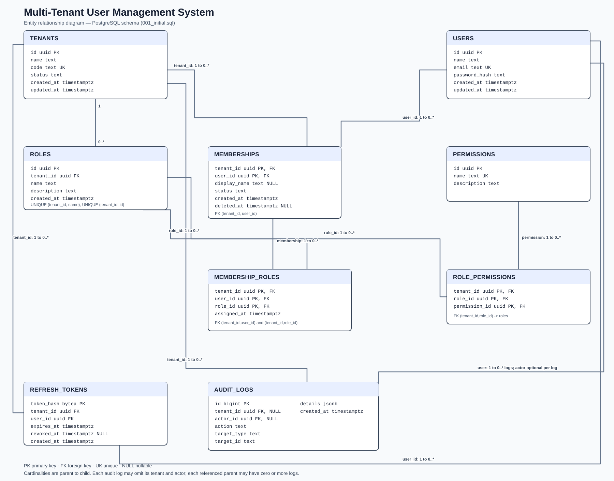
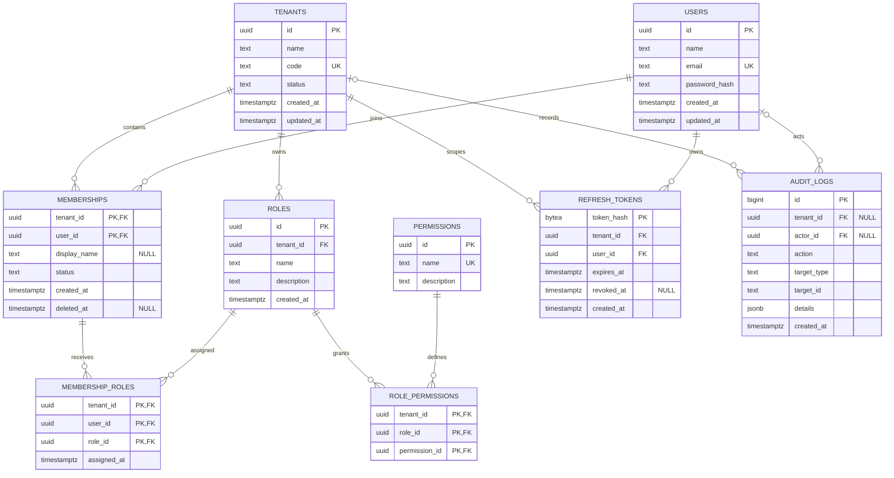

# Entity relationship diagram

This diagram reflects the tables and constraints in
[`001_initial.sql`](../internal/database/migrations/001_initial.sql).
`PK` marks primary-key columns, `FK` foreign keys, `UK` unique columns, and
`NULL` nullable columns. PostgreSQL defaults and check constraints are described
below the diagram.

The SVG above is the rendered diagram; the Mermaid definition below is its
editable source.

## Relationship and constraint details

- `memberships` has a composite primary key `(tenant_id, user_id)` and
  references both `tenants.id` and `users.id`. A user can therefore join
  multiple tenants. `deleted_at` is the membership soft-delete marker.
- `roles` belongs to one tenant. Role names are unique within a tenant, and
  `(tenant_id, id)` is also unique so the junction tables can reference a role
  together with its tenant.
- `membership_roles` links a membership to a role. Its composite foreign keys
  `(tenant_id, user_id)` and `(tenant_id, role_id)` ensure the membership and
  role belong to the same tenant.
- `role_permissions` links a tenant role to a shared permission-catalog entry.
  Its `(tenant_id, role_id)` foreign key prevents attaching permissions through
  a role owned by another tenant.
- `refresh_tokens` has separate foreign keys to a tenant and user; the schema
  does not define a composite constraint tying those two references to a
  membership.
- `audit_logs.tenant_id` and `audit_logs.actor_id` are nullable references.
  This allows audit entries without an associated tenant or user actor.
- `users.email` has a unique constraint and a unique index on `lower(email)`.
  Tenant codes and permission names are unique. UUID primary keys default to
  `gen_random_uuid()`; timestamps and `audit_logs.details` have database
  defaults defined in the migration.

Tenant status is constrained to `active` or `suspended`; membership status is
constrained to `active` or `suspended`. Permission names use the
`resource:action` format. The migration also creates indexes for tenant-scoped
role lookups, membership and role-assignment lookups, refresh-token expiry,
and audit lookups by tenant or actor and time.

The migration runner creates `schema_migrations` as operational bookkeeping;
it is omitted from this domain ERD.
